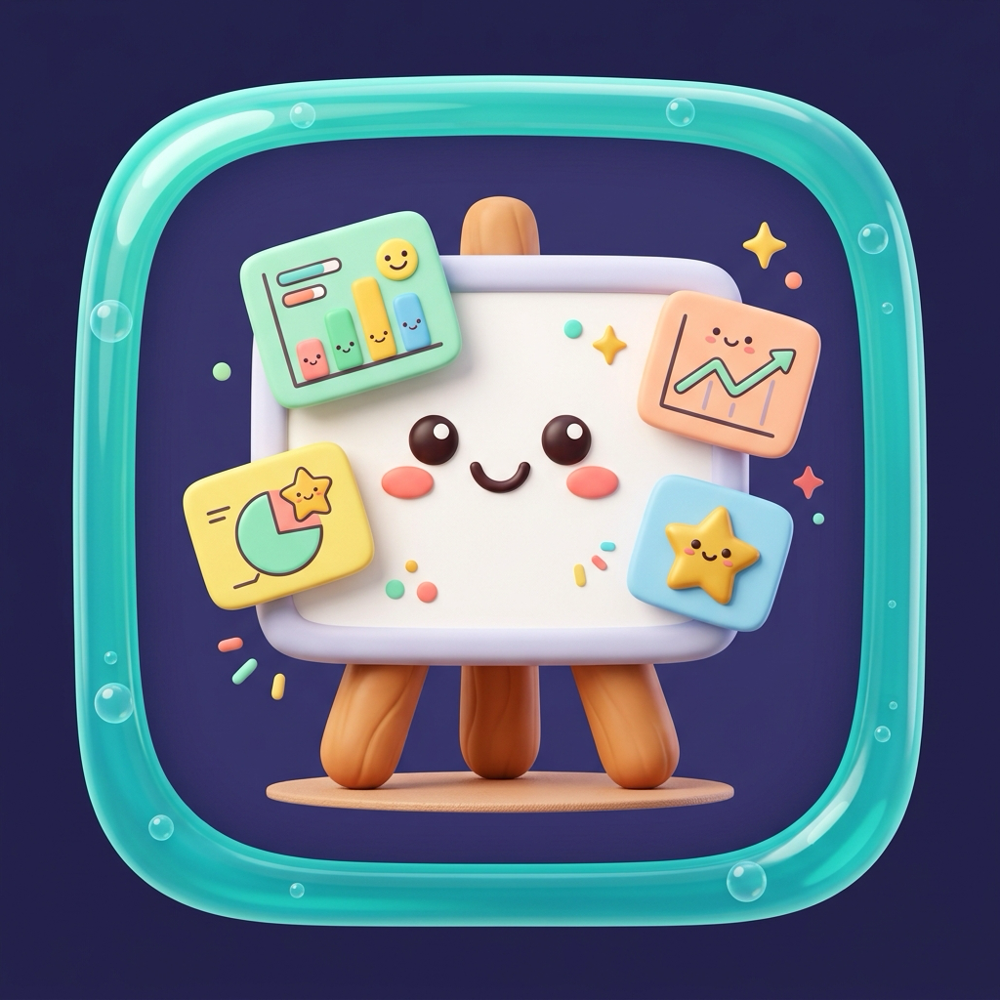

<p align="center">
  <a href="#readme"><strong>📖 README</strong></a> &nbsp;•&nbsp;
  <a href="CONTRIBUTING.md"><strong>🤝 Contributing</strong></a> &nbsp;•&nbsp;
  <a href="LICENSE"><strong>⚖️ MIT License</strong></a>
</p>

<p align="center">
  
</p>

<h1 align="center">Kids Camp Activities</h1>
<h3 align="center">Interactive Game Presentation Deck</h3>

<p align="center">
  A sleek, high-performance, full-screen interactive presentation deck crafted for camp leaders, counselors, and volunteers to present and facilitate camp games for kids with ease.
</p>

<p align="center">
  <a href="https://vitejs.dev/"></a>
  
  
  
  
  <a href="LICENSE"></a>
</p>

---

## 🌟 Highlights & Features

- **🎯 Age-Tailored Tracks**: Instantly filter and launch games tailored for **🎈 Kids (Age 3–6)** or **🚀 Older Kids (Age 7+)**.
- **🎨 Warm Pastel Editorial Canvas**: Clean, spacious desk aesthetic (`#fbf8f1`) featuring bespoke signature pastel color themes for every single game.
- **📸 3-Column Facilitator View**:
  1. **DIY Craft Card**: Real workshop craft photo with concise preparation details.
  2. **Gameplay Diagram**: Clear court layout diagram with straightforward 3-step rules.
  3. **Supplies & Coach Tips**: Complete materials checklist and counselor facilitation advice.
- **⏱️ Built-in Facilitator Tools**: Slide catalog drawer, facilitator rules sheet, photo lightbox, and progress tracking.
- **⚡ Zero Sound FX Distractions**: Built strictly with zero audio dependencies so counselors can lead games without distracting sound loops or unwanted noise.
- **📱 Fully Responsive**: Optimized for large projector screens, iPads/tablets, and mobile counselor phones.

---

## 🎮 Game Catalog

### 🎈 Kids Track (Age 3–6)
*Gentle motor coordination, safe obstacle navigation, cooperative relay, and charades guessing.*

| # | Game Title | Theme & Focus | Signature Pastel |
|---|---|---|---|
| **01** | **Goliath SlingShot** | Balloon-cup launcher target practice into giant box | Meadow Pistachio (`#f2f8e8`) |
| **02** | **Feed Goliath Game** | Ball-toss feeding challenge into Goliath's mouth | Warm Peach (`#fff1ec`) |
| **03** | **Goliath's Footprint Stomp & Toss** | Big-step footprint agility course & beanbag landing | Blossom Blush (`#fdf2f4`) |
| **04** | **Find the David** | Memory card grid & anointing of God's chosen king | Royal Periwinkle (`#f4f6fe`) |
| **05** | **Miracle Motion** | Bible charades & silent action guessing (5 marks to pass) | Sunny Buttercup (`#fdfce8`) |

### 🚀 Older Kids Track (Age 7+)
*Speed, precision aiming, dual-string balance coordination, and strategic team play.*

| # | Game Title | Theme & Focus | Signature Pastel |
|---|---|---|---|
| **06** | **Reaction Ball & Cup Game** | Fast reflexes, dual-string balance & cup drop | Powder Sky Blue (`#eaf4fc`) |
| **07** | **David & Goliath Sliding Game** | Dual-string pulley steering & precision ring drop | Dreamy Lilac (`#f2ecfc`) |
| **08** | **Brook of Elah River Crossing** | Stepping stone floor balance & river sprint | Lagoon Aqua (`#eaf7f5`) |
| **09** | **The Wind of Elah** | Handheld fan wind race herding paper stones | Papaya Breeze (`#fff7f0`) |
| **10** | **Faith & Balance** | Spoon-and-ball balance navigation & 2-min basket relay | Emerald Mint (`#edfbf5`) |

---

## 🎨 Design System

All visual components adhere to our minimal editorial design rules:
- **Palette**: Warm pastel desk canvas (`#fbf8f1` / `#fcf9f2`) with soft ambient glows.
- **Typography**: `Outfit` for bold modern headings, `Plus Jakarta Sans` for body copy, and `JetBrains Mono` for badges and metadata.
- **Top Pill Header**: Category indicator on left, zero-padded slide number (`01`–`10`) in the center, and camp date badge on right.

---

## ⌨️ Facilitator Keyboard Shortcuts

| Key | Action |
|---|---|
| `Space` / `→` / `↓` / `N` | Advance to next slide |
| `←` / `↑` / `P` | Go back to previous slide |
| `Home` / `End` | Jump to first / last slide |
| `H` | Return to Launchpad / Home view |
| `R` | Toggle Game Rules sheet |
| `Esc` | Close the top-most overlay (lightbox, rules, drawer) |

---

## 🚀 Quick Start & Development

### Prerequisites
- Node.js (v18 or higher recommended)
- npm or pnpm

### Installation
```bash
# Clone the repository
git clone https://github.com/desmondlee95700/presentation_web.git

# Navigate to project directory
cd presentation_web

# Install dependencies
npm install

# Start local dev server
npm run dev
```
Open [http://localhost:5173](http://localhost:5173) in your browser.

### Production Build
```bash
# Build optimized bundle
npm run build

# Preview production build locally
npm run preview

# Check game data (fields, images, categories)
npm run validate
```

---

## 📁 Project Structure

```
presentation_web/
├── public/
│   ├── app-icon.png, favicon*.png, apple-touch-icon.png
│   └── images/
│       ├── games/<game-id>/       # craft.webp + setup.webp|svg per game
│       └── mascots/               # Landing page characters
├── src/
│   ├── main.js                    # Entry point: wires components together
│   ├── app/                       # Router, overlays, keyboard, swipe
│   ├── components/                # Slide deck, slide, dock, drawer, modals, landing
│   ├── data/
│   │   ├── site.js                # Camp label & theme
│   │   ├── categories.js          # Age groups & their games
│   │   └── games/                 # One file per game (+ index.js)
│   ├── lib/dom.js                 # Small DOM helpers
│   └── styles/                    # Per-component CSS, entry: index.css
├── scripts/validate-games.js      # Catalog checks (npm run validate)
├── index.html
├── CONTRIBUTING.md
├── LICENSE
├── package.json
└── vite.config.js
```

See **Adding a game** in [AGENTS.md](AGENTS.md).

---

## 🤝 Contributing

Contributions, game suggestions, and improvements are always welcome! Please check out [CONTRIBUTING.md](CONTRIBUTING.md) for details on guidelines and our pull request process.

---

## ⚖️ License

This project is licensed under the [MIT License](LICENSE) — see the [LICENSE](LICENSE) file for details.
